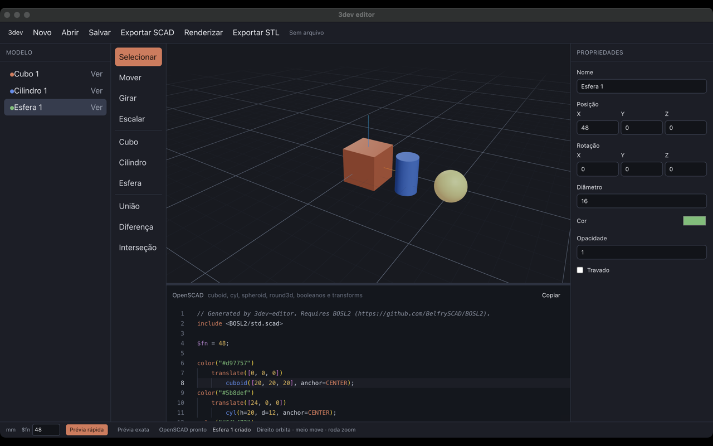
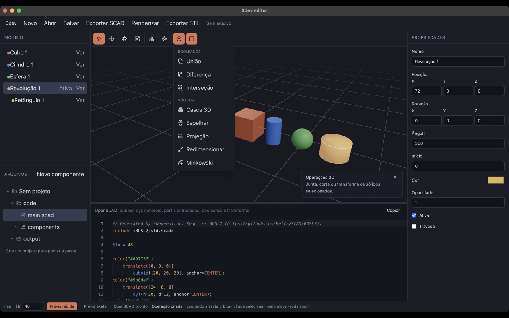

# 3dev editor

Editor 3D paramétrico para desktop. A modelagem acontece numa vista isométrica e o aplicativo gera OpenSCAD com [BOSL2](https://github.com/BelfrySCAD/BOSL2). O código pode ser editado e volta para a cena.

Um projeto é uma pasta, com o documento, o `main.scad`, componentes e os modelos exportados (STL, OBJ e 3MF). Feito com Electron, React, TypeScript, Three.js e Monaco. O gerenciador de pacotes do projeto é o `pnpm`.



## Executar

```bash
pnpm install
pnpm dev
```

A prévia exata, a exportação de STL, OBJ e 3MF, a importação de SVG e os diálogos de arquivo rodam na janela Electron. O OpenSCAD precisa estar instalado para a prévia exata e para os modelos. A prévia rápida, feita com Three.js e Manifold, funciona sem ele.

```bash
pnpm build:mac
pnpm build:win
pnpm build:linux
```

## O que a janela faz

- **Projeto:** modal para criar, abrir ou retomar um recente. A coluna esquerda mostra o modelo e a pasta (`code`, `components`, `output`).
- **Formas:** cubo, cilindro, esfera, retângulo, círculo, elipse, polígono, estrela, texto e SVG. Perfis 2D são extrudados.
- **Ferramentas:** selecionar, mover, girar e escalar. Arrastar com o botão esquerdo orbita a câmera; um clique seleciona o sólido.
- **Operações 3D:** união, diferença, interseção, casca 3D, espelhar, projeção, redimensionar e Minkowski.
- **Operações 2D:** offset, casca convexa e revolução de um perfil. Clicar de novo na mesma operação ativa ou desativa o grupo.
- **Dica da função:** um cartão no canto do viewport explica a ferramenta ou o item sob o cursor.
- **Componentes:** cada um é um módulo OpenSCAD e pode ser instanciado na cena.
- **OpenSCAD:** fonte gerado em tempo real, com edição de volta para o modelo.
- **Propriedades:** posição, rotação, dimensões, extrusão, parâmetros da operação, cor, opacidade, atividade e trava.

O guia completo, com a câmera, o formato do documento, as duas prévias e o mapa do código, está em [docs/como-funciona.md](docs/como-funciona.md).


