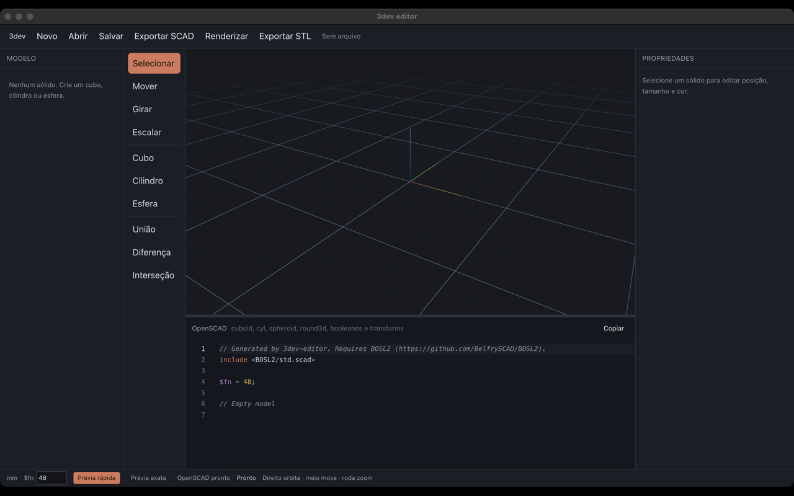
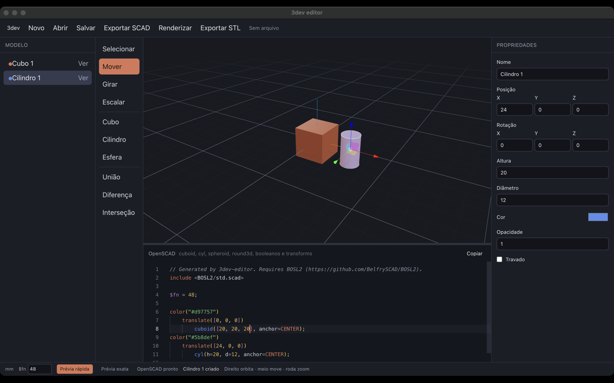

# Como o 3dev editor funciona

O 3dev editor é um aplicativo de desktop para modelar sólidos em milímetros e gerar OpenSCAD com a biblioteca [BOSL2](https://github.com/BelfrySCAD/BOSL2). A cena é editada numa vista 3D; o código OpenSCAD é gerado ao mesmo tempo e pode ser editado de volta para o modelo.

As imagens abaixo foram capturadas com o aplicativo em execução (`pnpm dev`), na câmera padrão do viewport: eixo Z para cima e enquadramento isométrico.

## Executar

O projeto usa somente `pnpm`.

```bash
pnpm install
pnpm dev
```

O comando sobe o Vite do renderer em `http://localhost:5173` e abre a janela Electron (1440×900, mínimo 960×640). Arquivos, detecção do OpenSCAD e a prévia exata existem nessa janela. No navegador, a interface desenha a cena, mas a barra de status avisa que o OpenSCAD fica no Electron.

Builds empacotados:

```bash
pnpm build:mac
pnpm build:win
pnpm build:linux
```

O pacote copia `resources/BOSL2` para os recursos do aplicativo. Em desenvolvimento, a biblioteca é lida de `resources/BOSL2`.

## A interface

A janela tem seis regiões.



| Região | Função |
| --- | --- |
| Barra superior | Novo, Abrir, Salvar, Exportar SCAD, Renderizar e Exportar STL. À direita, o caminho do arquivo aberto. |
| Modelo | Árvore dos sólidos raiz. Filhos de uma operação booleana aparecem indentados. |
| Ferramentas | Selecionar, Mover, Girar, Escalar, primitivas e booleanos. |
| Viewport | Cena Three.js, grade de 10 mm, eixos e câmera isométrica. |
| OpenSCAD | Editor Monaco com o fonte gerado. Pode ser editado. |
| Propriedades | Nome, transformação, dimensões, cor, opacidade e trava do sólido selecionado. |
| Barra de status | Unidade (`mm`), `$fn`, modo de prévia, disponibilidade do OpenSCAD e a última mensagem. |

A câmera nasce em `[90, -140, 80]`, com “cima” em Z, olhando para a origem. Botão direito orbita, botão do meio desloca, roda aproxima. O botão esquerdo fica livre para selecionar sólidos e usar os gizmos.

## Criar sólidos

Cada primitiva entra como um nó raiz, 24 mm à direita do anterior, com uma cor da paleta.

| Primitiva | Medidas iniciais |
| --- | --- |
| Cubo | 20 × 20 × 20 mm. Arredondamento e chanfro começam em 0 e são mutuamente exclusivos. |
| Cilindro | Altura 20 mm, diâmetro 12 mm. |
| Esfera | Diâmetro 16 mm. |


No painel Modelo, o clique seleciona. Shift acrescenta ou tira o item da seleção. **Ver** / **Oculto** alterna `visible`. Um sólido oculto some da cena e do OpenSCAD gerado.

Dimensões positivas têm piso de 0,1 mm. O raio de aresta de um cubo não passa da metade da menor aresta. Em cubo, um arredondamento maior que zero zera o chanfro, e o contrário também.

## Mover, girar e escalar

Com um sólido selecionado e destravado, **Mover**, **Girar** e **Escalar** mostram o gizmo local do Three.js.



Ao soltar o gizmo, a posição e a rotação (em graus, ordem XYZ) entram no documento. A escala não fica como fator: ela é gravada nas dimensões.

- Cubo: cada eixo multiplica o tamanho correspondente.
- Cilindro: a média de X e Y altera o diâmetro; Z altera a altura.
- Esfera: a média dos três eixos altera o diâmetro.
- Booleano: a posição dos filhos é escalada, e o arredondamento usa a média dos fatores.

Os mesmos números podem ser digitados em Propriedades. Arrastar o controle de aresta atualiza a prévia na hora e grava um único passo de desfazer ao soltar.

**Travado** impede mudança de geometria e o gizmo. Visibilidade e a própria trava continuam editáveis.

## Operações booleanas

**União**, **Diferença** e **Interseção** exigem pelo menos dois sólidos selecionados. A operação falha se algum já pertence a outro booleano ou se um é ancestral do outro.

O novo nó fica na média das posições dos selecionados. Os filhos passam a ser relativos a esse centro e deixam de aparecer como raízes. Na prévia rápida, o resultado é uma malha só; um filho selecionado ainda pode ser visto como fantasma.

A diferença segue a ordem da seleção: o primeiro sólido é a base e os seguintes são subtraídos. No OpenSCAD isso vira `difference()`, `union()` ou `intersection()`.

Apagar um booleano apaga a subárvore. Se um booleano ficar com menos de dois filhos, ele é desfeito: o filho restante volta ao pai, com a transformação composta.

Um booleano também tem arredondamento. Quando ele é maior que zero, o gerador envolve a operação em `round3d` do BOSL2.

## O documento

O estado vive num store Zustand. O documento é a fonte da cena e do código.

```json
{
  "version": 1,
  "name": "Sem título",
  "units": "mm",
  "fn": 48,
  "nodes": {}
}
```

Cada nó tem `id`, `name`, `visible`, `locked`, `consumedBy`, `transform` e `appearance`. `consumedBy` aponta para o booleano pai, ou `null` se o nó é raiz. O tipo do nó é `cuboid`, `cylinder`, `sphere`, `union`, `difference` ou `intersection`.

Há no máximo 50 passos de desfazer. Atalhos, fora de campos de texto e do editor de código:

| Atalho | Efeito |
| --- | --- |
| Cmd/Ctrl+Z | Desfazer |
| Cmd/Ctrl+Shift+Z | Refazer |
| Delete ou Backspace | Apagar a seleção, se nenhum item estiver travado |
| Escape | Limpar a seleção |

`$fn` fica entre 8 e 256. Ele define a resolução das curvas no OpenSCAD e, na prévia rápida, o número de segmentos (limitado a 128 na malha Three.js).

## Do modelo ao OpenSCAD

Toda mudança do documento recalcula o fonte. O cabeçalho é fixo:

```openscad
// Generated by 3dev-editor. Requires BOSL2 (https://github.com/BelfrySCAD/BOSL2).
include <BOSL2/std.scad>

$fn = 48;
```

Só as raízes visíveis são emitidas. A ordem dos modificadores é cor, translação e rotação. Rotação zero é omitida. Cor padrão `#c4ccd4` e opacidade 1 também são omitidas.

| Nó | Chamada BOSL2 |
| --- | --- |
| Cubo | `cuboid([x, y, z], rounding=… ou chamfer=…, anchor=CENTER)` |
| Cilindro | `cyl(h=…, d=…, anchor=CENTER)` |
| Esfera | `spheroid(d=…, anchor=CENTER)` |
| Booleano | `union()`, `difference()` ou `intersection()`, com `round3d` se houver raio |

O painel de código aplica o texto de volta cerca de 320 ms depois da última digitação, ou ao sair do editor. O parser aceita o subconjunto que o próprio editor gera: `$fn`, `include <BOSL2/std.scad>`, `color`, `translate`, `rotate`, `cuboid`, `cyl`, `spheroid`, `round3d` e os três booleanos. Um erro marca a linha no Monaco e não substitui o documento. Uma edição válida vira um passo de desfazer, com a mensagem “Modelo atualizado pelo código”.

## Duas prévias

**Prévia rápida** é o modo inicial. Primitivas são malhas Three.js. Booleanos são calculados com Manifold (WebAssembly) num worker, primeiro sem o arredondamento de aresta e depois com ele, quando existe raio. Dá para orbitar e editar enquanto isso roda.

**Prévia exata** pede ao processo principal um STL. O fluxo é:

1. O renderer envia o fonte pelo canal `preview:stl`.
2. O main grava um `.scad` temporário e chama o binário do OpenSCAD com `OPENSCADPATH` apontando para o diretório pai de `resources/BOSL2`.
3. O STL volta para o viewport e substitui a malha rápida por uma malha cinza.
4. O resultado fica em cache por hash do fonte (até 8 entradas). O tempo limite é 120 segundos.

O OpenSCAD é procurado em `OPENSCAD_BIN`, no aplicativo do macOS, no Homebrew, em `/usr/local/bin`, em `/usr/bin` e, por último, no `PATH`. Sem o binário, a prévia rápida continua. **Renderizar** e **Prévia exata** disparam esse caminho. **Exportar STL** usa o mesmo render e grava o arquivo escolhido no diálogo.

## Arquivos

| Ação | Resultado |
| --- | --- |
| Salvar | JSON do documento, sugerido como `model.3dev.json`. Um segundo salvar reutiliza o caminho. |
| Abrir | Lê esse JSON, valida a versão 1 e substitui o documento. O histórico é zerado. |
| Exportar SCAD | Grava o fonte atual em `.scad`. |
| Exportar STL | Renderiza com OpenSCAD e grava `.stl`. |
| Novo | Documento vazio, sem arquivo associado. |

Os canais IPC ficam em `src/shared/api.ts` e são expostos pelo preload como `window.api`.

## Como o código está dividido

```
src/main          janela Electron, diálogos e OpenSCAD
src/preload       ponte segura para o renderer
src/shared        contratos dos canais IPC
src/renderer      interface React
resources/BOSL2   biblioteca incluída no OpenSCAD gerado
```

No renderer:

| Pasta | Responsabilidade |
| --- | --- |
| `document/` | Tipos, árvore, histórico e store. |
| `codegen/` | Geração e parse do OpenSCAD. |
| `viewport/` | Canvas, câmera, malhas e gizmos. |
| `preview/` | Manifold para booleanos e carga do STL exato. |
| `ui/` | Barras, árvore, propriedades e o editor Monaco. |
| `editor/` | Configuração do Monaco para OpenSCAD. |

O processo principal não interpreta a cena. Ele só detecta o OpenSCAD, renderiza STL e lê ou grava arquivos. A cena, o desfazer e a geração de código acontecem no renderer.
