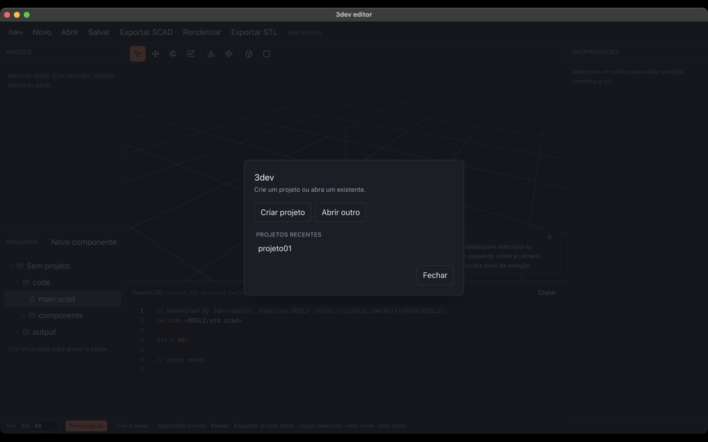
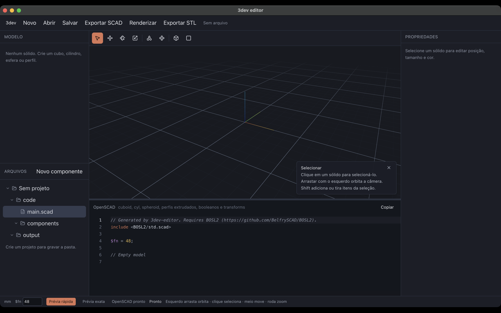
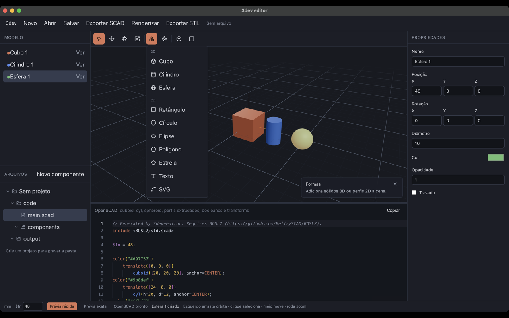
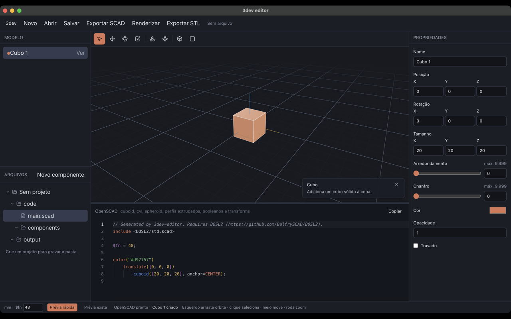
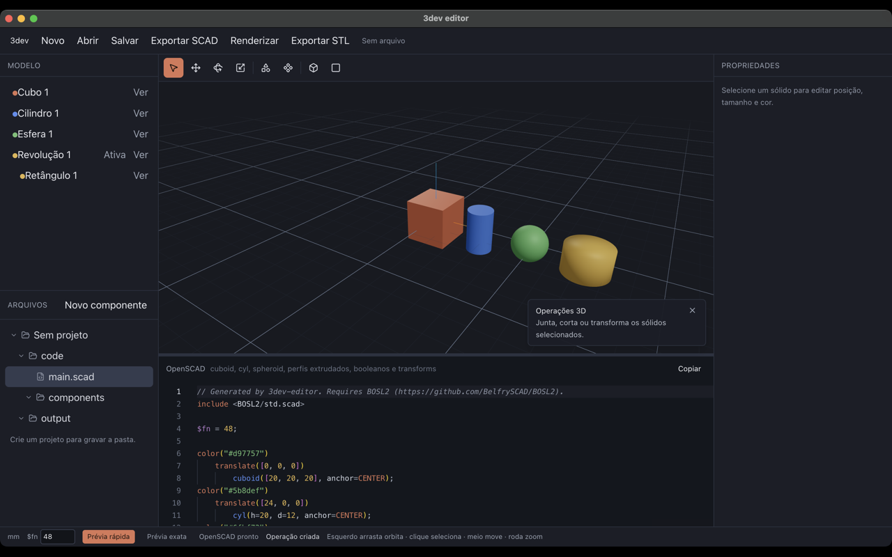
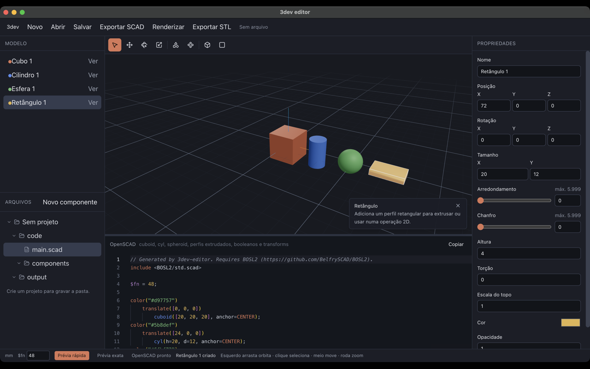
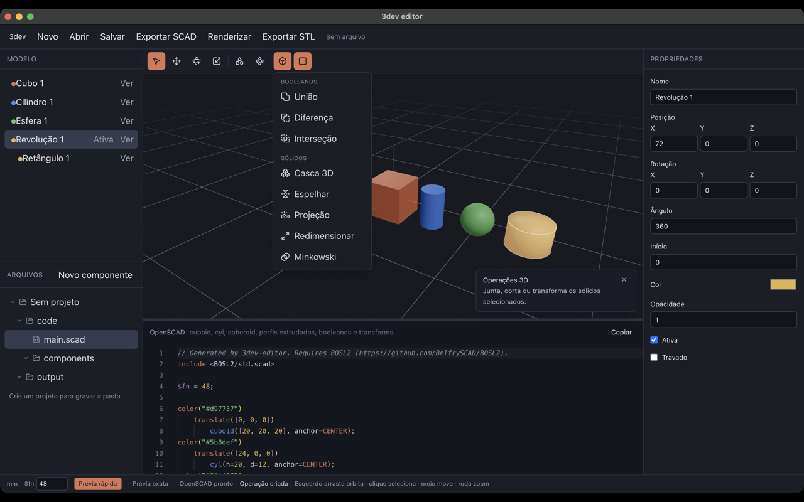
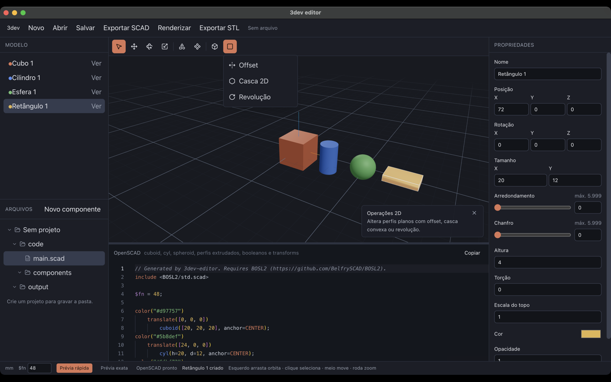
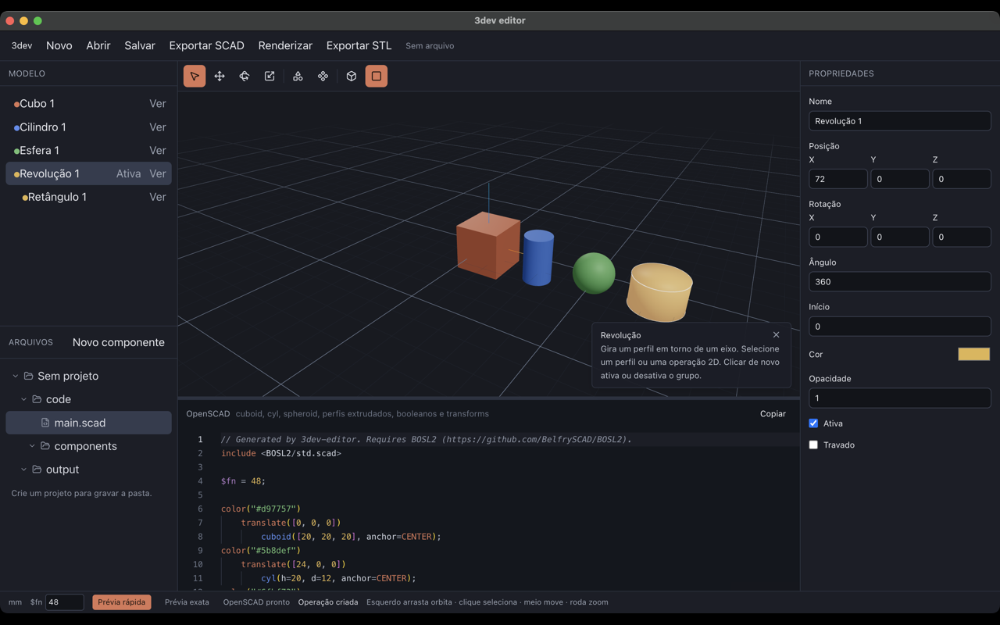

# Como o 3dev editor funciona

O 3dev editor é um aplicativo de desktop para modelar sólidos em milímetros e gerar OpenSCAD com a biblioteca [BOSL2](https://github.com/BelfrySCAD/BOSL2). A cena é editada numa vista 3D; o código OpenSCAD é gerado ao mesmo tempo e pode ser editado de volta para o modelo.

Um projeto é uma pasta. Dentro dela cabem o documento, o `main.scad`, componentes e o STL exportado. A cena ativa é um desses arquivos: o principal ou um componente.

As imagens abaixo foram capturadas com o aplicativo em execução (`pnpm dev`), na câmera padrão do viewport: eixo Z para cima e enquadramento isométrico.

## Executar

O projeto usa somente `pnpm`.

```bash
pnpm install
pnpm dev
```

O comando sobe o Vite do renderer em `http://localhost:5173` e abre a janela Electron (1440×900, mínimo 960×640). Arquivos, detecção do OpenSCAD, importação de SVG e a prévia exata existem nessa janela. No navegador, a interface desenha a cena, mas a barra de status avisa que o OpenSCAD fica no Electron.

Builds empacotados:

```bash
pnpm build:mac
pnpm build:win
pnpm build:linux
```

O pacote copia `resources/BOSL2` para os recursos do aplicativo. Em desenvolvimento, a biblioteca é lida de `resources/BOSL2`.

## A interface

Ao abrir, um modal oferece criar um projeto, abrir outro arquivo ou retomar um recente. Fechar o modal, ou clicar fora dele, deixa um documento vazio, sem pasta.



A janela tem a barra de menu, a coluna esquerda, a barra de ferramentas, o viewport, o código, as propriedades e a barra de status.



| Região | Função |
| --- | --- |
| Barra superior | Novo, Abrir, Salvar, Exportar SCAD, Renderizar e Exportar STL. À direita, a pasta do projeto ou “Sem arquivo”. |
| Modelo | Sólidos raiz do arquivo ativo. Filhos de um booleano aparecem indentados. |
| Arquivos | Árvore da pasta, com ícone de pasta ou de arquivo: JSON, `code/main.scad`, `components` e `output`. As pastas abrem e fecham. **Novo componente** cria o arquivo na hora. |
| Ferramentas | Ícones de selecionar, mover, girar e escalar; menus de formas, componentes, operações 3D e operações 2D. |
| Viewport | Cena Three.js, grade de 10 mm, eixos, câmera isométrica e o cartão que explica a função atual. |
| OpenSCAD | Editor Monaco com o fonte do arquivo ativo. Pode ser editado. |
| Propriedades | Nome, transformação, dimensões, extrusão, cor, opacidade e trava do item selecionado. |
| Barra de status | Unidade (`mm`), `$fn`, modo de prévia, disponibilidade do OpenSCAD e a última mensagem. |

A câmera nasce em `[90, -140, 80]`, com “cima” em Z, olhando para a origem. Arrastar com o botão esquerdo orbita; um clique seleciona o sólido. Shift, Ctrl ou Cmd no arrasto deixam o botão livre para a seleção e para os gizmos. O botão do meio desloca a vista e a roda aproxima. O botão direito abre o menu de contexto para acrescentar uma forma ou um componente.

No canto inferior direito do viewport, um cartão explica a ferramenta ativa. Passar o cursor por um ícone ou item de menu troca o texto. O X fecha o cartão até a próxima função.

## Formas

O menu **Formas** separa primitivas 3D e perfis 2D. O mesmo menu aparece no clique direito do viewport. Cada forma entra como nó raiz, 24 mm à direita da anterior, com uma cor da paleta.



| Forma | Medidas iniciais |
| --- | --- |
| Cubo | 20 × 20 × 20 mm. Arredondamento e chanfro começam em 0 e são mutuamente exclusivos. |
| Cilindro | Altura 20 mm, diâmetro 12 mm. |
| Esfera | Diâmetro 16 mm. |
| Retângulo | 20 × 12 mm, extrudado 4 mm. |
| Círculo | Diâmetro 16 mm, extrudado 4 mm. |
| Elipse | 20 × 12 mm, extrudada 4 mm. |
| Polígono | 6 lados, diâmetro 16 mm, extrudado 4 mm. |
| Estrela | 5 pontas, diâmetro 18 mm, diâmetro interno 8 mm, extrudada 4 mm. |
| Texto | “Texto”, 10 mm, fonte Liberation Sans, extrudado 4 mm. |
| SVG | Arquivo escolhido no disco, extrudado 4 mm. Só no Electron. |





Um perfil 2D vira sólido por `linear_extrude`. A extrusão tem altura, torção e escala do topo. A escala 1 mantém o perfil; 0 fecha a peça num ponto.



No painel Modelo, o clique seleciona. Shift acrescenta ou tira o item da seleção. **Ver** / **Oculto** alterna `visible`. Um item oculto some da cena e do OpenSCAD gerado.

Dimensões positivas têm piso de 0,1 mm. O raio de aresta de um cubo ou retângulo não passa da metade da menor aresta. Arredondamento e chanfro continuam mutuamente exclusivos. Um polígono tem de 3 a 32 lados; uma estrela, de 3 a 32 pontas.

## Mover, girar e escalar

Com um item selecionado e destravado, **Mover**, **Girar** e **Escalar** mostram o gizmo local do Three.js. Ao soltar o gizmo, a posição e a rotação (em graus, ordem XYZ) entram no documento. A escala não fica como fator solto na primitiva: ela é gravada nas dimensões.

- Cubo: cada eixo multiplica o tamanho correspondente.
- Cilindro: a média de X e Y altera o diâmetro; Z altera a altura.
- Esfera: a média dos três eixos altera o diâmetro.
- Perfil: a média de X e Y altera o desenho; Z altera a altura da extrusão.
- Booleano: a posição dos filhos é escalada, e o arredondamento usa a média dos fatores.
- Instância de componente: o gizmo grava o fator de escala do próprio nó.

Os mesmos números podem ser digitados em Propriedades. Arrastar o controle de aresta atualiza a prévia na hora e grava um único passo de desfazer ao soltar.

**Travado** impede mudança de geometria e o gizmo. Visibilidade e a própria trava continuam editáveis.

## Operações

Os menus **Operações 3D** e **Operações 2D** agrupam os sólidos selecionados. O novo nó fica na média das posições. Os filhos passam a ser relativos a esse centro e aparecem indentados no Modelo. A operação falha se algum item já pertence a outro grupo ou se um é ancestral do outro.

Clicar de novo na mesma operação, com o grupo selecionado, alterna **Ativa**. Desativada, os filhos continuam na árvore e o efeito some da cena e do OpenSCAD. O botão do menu fica destacado enquanto o grupo selecionado está ativo.



| Operação | O que exige | OpenSCAD |
| --- | --- | --- |
| União, diferença, interseção | Pelo menos dois sólidos. A diferença usa o primeiro da seleção como base. | `union()`, `difference()`, `intersection()`. Com raio, envolve em `round3d`. |
| Casca 3D | Pelo menos dois sólidos. | `hull()` |
| Espelhar | Um sólido. O eixo começa em X. | `mirror([1, 0, 0])` e equivalentes |
| Projeção | Pelo menos um sólido. Vira perfil no plano XY e pode ser extrudado. `cut` começa falso. | `projection(cut=…)` |
| Redimensionar | Um sólido, no tamanho atual da peça. `auto` começa falso. | `resize([x, y, z], auto=…)` |
| Minkowski | Pelo menos dois sólidos. | `minkowski()` |



Offset, casca 2D e revolução só aceitam perfil, offset, casca 2D ou projeção.

| Operação | O que exige | OpenSCAD |
| --- | --- | --- |
| Offset | Pelo menos um perfil. Raio 1 mm no modo `radius`. | `offset(r=…)` ou `offset(delta=…, chamfer=…)` |
| Casca 2D | Pelo menos dois perfis. | `hull()` no plano, depois a extrusão |
| Revolução | Um perfil. Ângulo 360° e início 0. | `rotate_extrude(angle=…, start=…)` |



Apagar um grupo apaga a subárvore. Se um grupo ficar com menos filhos do que o mínimo, ele é desfeito e o que resta volta ao pai, com a transformação composta.

## Componentes

**Novo componente**, na árvore de arquivos, pede um nome e abre uma cena vazia. O arquivo `code/components/<Nome>.scad` é gravado na hora, sem usar **Salvar**. Se ainda não houver pasta, o aplicativo pede o local e cria o projeto antes. O nome precisa ser um identificador de OpenSCAD e não pode repetir um módulo já gerado pelo editor, como `cuboid` ou `union`.

O componente vira `code/components/<Nome>.scad`, com um `module` de mesmo nome. O arquivo principal faz `use` desse caminho quando instancia o componente. O menu **Componentes** e o menu de contexto colocam uma instância na cena ativa. Uma instância que fecharia um ciclo é recusada.

Clicar em `main.scad` ou num componente na árvore troca a cena e o código mostrados. O `$fn` continua sendo do projeto, não de um arquivo só.

## O documento

O estado vive num store Zustand. O documento, versão 2, guarda um arquivo principal e os componentes.

```json
{
  "version": 2,
  "name": "Sem título",
  "units": "mm",
  "fn": 48,
  "activeFile": "main",
  "files": {
    "main": { "nodes": {}, "assets": {} }
  }
}
```

Cada nó tem `id`, `name`, `visible`, `locked`, `consumedBy`, `transform` e `appearance`. Grupos também têm `enabled`: ausente ou verdadeiro aplica o efeito; falso mantém os filhos e pula a operação. `consumedBy` aponta para o grupo pai, ou `null` se o nó é raiz.

Os tipos são `cuboid`, `cylinder`, `sphere`, `union`, `difference`, `intersection`, `rect`, `circle`, `ellipse`, `ngon`, `star`, `text`, `svg`, `component`, `offset`, `hull2d`, `hull`, `mirror`, `revolve`, `projection`, `resize` e `minkowski`.

SVGs ficam em `assets` do arquivo que os usa, com o fonte original. Na exportação, cada um vira `code/3dev-assets/<id>.svg`.

Há no máximo 50 passos de desfazer. Atalhos, fora de campos de texto e do editor de código, e com o modal fechado:

| Atalho | Efeito |
| --- | --- |
| Cmd/Ctrl+Z | Desfazer |
| Cmd/Ctrl+Shift+Z | Refazer |
| Delete ou Backspace | Apagar a seleção, se nenhum item estiver travado |
| Escape | Limpar a seleção. Com um menu aberto, fecha o menu. |

`$fn` fica entre 8 e 256. Ele define a resolução das curvas no OpenSCAD e, na prévia rápida, o número de segmentos (limitado a 128 na malha Three.js).

## Do modelo ao OpenSCAD

Toda mudança do documento recalcula o fonte do arquivo ativo. O cabeçalho é fixo:

```openscad
// Generated by 3dev-editor. Requires BOSL2 (https://github.com/BelfrySCAD/BOSL2).
include <BOSL2/std.scad>

$fn = 48;
```

Se a cena usa componentes, entram linhas `use <...>`. Só as raízes visíveis são emitidas. A ordem dos modificadores é cor, translação e rotação. Rotação zero é omitida. Cor padrão `#c4ccd4` e opacidade 1 também são omitidas.

| Nó | Chamada |
| --- | --- |
| Cubo | `cuboid([x, y, z], rounding=… ou chamfer=…, anchor=CENTER)` |
| Cilindro | `cyl(h=…, d=…, anchor=CENTER)` |
| Esfera | `spheroid(d=…, anchor=CENTER)` |
| Retângulo, círculo, elipse, polígono, estrela, texto, SVG | perfil BOSL2 ou `import` dentro de `linear_extrude(height=…, center=true, twist=…, scale=…)` |
| Booleano | `union()`, `difference()` ou `intersection()`, com `round3d` se houver raio |
| Offset | `offset(r=…)` ou `offset(delta=…)` em volta do perfil, depois `linear_extrude` |
| Casca 2D | `hull()` dos perfis, depois `linear_extrude` |
| Casca 3D | `hull()` |
| Espelhar | `mirror([1, 0, 0])`, `mirror([0, 1, 0])` ou `mirror([0, 0, 1])` |
| Revolução | `rotate_extrude(angle=…, start=…)` |
| Projeção | `projection(cut=true ou false)`, depois a extrusão do perfil |
| Redimensionar | `resize([x, y, z], auto=…)` |
| Minkowski | `minkowski()` |
| Componente | `Nome();` |

Um grupo desativado emite os filhos sem a chamada da operação. Se houver mais de um filho, eles entram num `union()`.

Um componente exporta o módulo e ainda chama `Nome();` no fim do arquivo, para a prévia daquele arquivo sozinho.

O painel de código aplica o texto de volta cerca de 320 ms depois da última digitação, ou ao sair do editor. O parser aceita o subconjunto que o próprio editor gera. Um erro marca a linha no Monaco e não substitui o documento. Uma edição válida vira um passo de desfazer, com a mensagem “Modelo atualizado pelo código”.

## Duas prévias

**Prévia rápida** é o modo inicial. Primitivas e perfis são malhas Three.js. Booleanos e algumas combinações são calculados com Manifold (WebAssembly) num worker. Dá para orbitar e editar enquanto isso roda.

**Prévia exata** pede ao processo principal um STL do projeto inteiro. O fluxo é:

1. O renderer envia o `main.scad`, os componentes e os SVGs pelo canal `preview:stl`.
2. O main grava esses arquivos numa pasta temporária e chama o binário do OpenSCAD com `OPENSCADPATH` apontando para o diretório pai de `resources/BOSL2`.
3. O STL volta para o viewport e substitui a malha rápida por uma malha cinza.
4. O resultado fica em cache por hash do fonte (até 8 entradas). O tempo limite é 120 segundos.

O OpenSCAD é procurado em `OPENSCAD_BIN`, no aplicativo do macOS, no Homebrew, em `/usr/local/bin`, em `/usr/bin` e, por último, no `PATH`. Sem o binário, a prévia rápida continua. **Renderizar** e **Prévia exata** disparam esse caminho. **Exportar STL** usa o mesmo render e grava `output/<nome>.stl` no projeto.

## Arquivos

```
Nome/
  Nome.3dev.json
  code/
    main.scad
    components/
      Peca.scad
    3dev-assets/
      <id>.svg
  output/
    Nome.stl
```

| Ação | Resultado |
| --- | --- |
| Salvar | Sem projeto, pede a pasta e cria o JSON, `code/` e `output/`. Com projeto aberto, regrava o JSON, o `main.scad`, os componentes e os SVGs. |
| Novo componente | Grava `code/components/<Nome>.scad` assim que o nome é confirmado. Sem projeto, cria a pasta antes. |
| Abrir | Lê um `.3dev.json` e valida a versão 2. Se `code/` e `output/` estiverem ao lado, a árvore lista o projeto. O histórico é zerado. |
| Exportar SCAD | Grava o fonte em `code/`. Sem projeto, salva antes. |
| Exportar STL | Renderiza com OpenSCAD e grava `output/<nome>.stl`, substituindo o arquivo anterior. Sem projeto, salva antes. |
| Novo | Reabre o modal. Criar projeto substitui a cena por um documento vazio nessa pasta. |

A lista de recentes fica neste computador, com no máximo 8 projetos. Criar ou abrir um projeto coloca o item no topo. Um atalho cujo arquivo sumiu sai da lista.

Os canais IPC ficam em `src/shared/api.ts` e são expostos pelo preload como `window.api`.

## Como o código está dividido

```
src/main          janela Electron, diálogos, pasta do projeto e OpenSCAD
src/preload       ponte segura para o renderer
src/shared        contratos dos canais IPC e o layout da pasta
src/renderer      interface React
resources/BOSL2   biblioteca incluída no OpenSCAD gerado
```

No renderer:

| Pasta | Responsabilidade |
| --- | --- |
| `document/` | Tipos, arquivos do projeto, árvore, histórico e store. |
| `codegen/` | Geração e parse do OpenSCAD. |
| `viewport/` | Canvas, câmera, malhas, gizmos e menu de contexto. |
| `preview/` | Manifold, contornos 2D, texto, SVG e carga do STL exato. |
| `ui/` | Barras, árvore, arquivos, propriedades e o editor Monaco. |
| `editor/` | Configuração do Monaco para OpenSCAD. |

O processo principal não interpreta a cena. Ele detecta o OpenSCAD, renderiza STL e lê ou grava a pasta do projeto. A cena, o desfazer e a geração de código acontecem no renderer.
